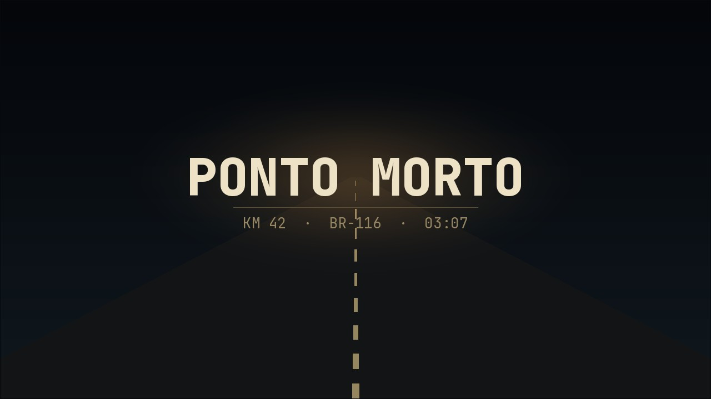

<p align="center">
  
</p>

<h1 align="center">Ponto Morto</h1>

<p align="center">
  <em>Um protótipo de visual novel de terror psicológico, feito em Ren'Py.</em>
</p>

---

## Sobre

**Ponto Morto** é uma visual novel curta de terror, ambientada num posto de gasolina perdido no
Km 42 da BR-116. Uma noite, um turno, três finais — e a sensação de que a estrada não leva a
lugar nenhum.

Todo o texto, a arte (pixel art procedural) e o som (sintetizado) foram gerados do zero para o
projeto, sem assets externos.

## Sinopse

> Km 42 da BR-116. Três e sete da manhã.
>
> Marta cumpre mais um turno da noite quando a campainha toca. Entra um homem molhado dos ombros
> aos pés — e ela não ouviu carro nenhum chegar. Não chove há semanas.

## Como jogar

- **Avançar o diálogo:** clique, `Espaço` ou `Enter`
- **Abrir o menu:** clique direito ou `Esc`
- **Pular:** segure `Ctrl`
- **Voltar um trecho:** `Page Up`
- **Esconder a interface:** `H`
- **Tela cheia:** `Alt` + `Enter`

As escolhas mudam o desfecho. Existem **três finais**.

## Rodar o jogo

Requer o [Ren'Py 8.3.4](https://www.renpy.org/) (SDK).

```bash
# direto pelo SDK
caminho/para/renpy-8.3.4-sdk/renpy.sh caminho/para/ponto-morto
```

Ou abra o **launcher** do Ren'Py e selecione a pasta do projeto.

## Estrutura

```
ponto-morto/
├─ game/
│  ├─ script.rpy        # história, diálogos e escolhas
│  ├─ definitions.rpy   # imagens e personagens
│  ├─ options.rpy       # configurações do projeto
│  ├─ screens.rpy       # interface (menus, HUD)
│  ├─ images/           # fundos e sprites
│  ├─ audio/            # trilha e efeitos (sintetizados)
│  └─ fonts/
├─ tools/
│  ├─ gen_images.py     # gera fundos, sprites e ícones
│  └─ gen_audio.py      # gera a trilha e os efeitos
├─ android-icon_foreground.png   # ícone adaptativo (frente, transparente)
├─ android-icon_background.png   # ícone adaptativo (fundo, opaco)
└─ android-presplash.jpg         # tela de carregamento
```

## Regenerar a arte e o áudio

Requer Python 3 com [Pillow](https://pypi.org/project/Pillow/) (imagens) e `ffmpeg` (áudio).

```bash
python3 tools/gen_images.py   # fundos, sprites, ícones Android e presplash
python3 tools/gen_audio.py    # trilha e efeitos em .ogg
```

## Build para Android

1. Instale o **RAPT** (Ren'Py Android Packaging Tool) pelo launcher: menu **Android**.
2. Na primeira build, configure o `android.json` (nome do pacote, orientação etc.).
3. Gere o pacote pelo launcher: **Build Distributions → Android**.

Os ícones já estão no formato exigido pelo RAPT — `android-icon_foreground.png` (432×432,
transparente) e `android-icon_background.png` (432×432, opaco), além do `android-presplash.jpg`.
O RAPT cuida de gerar as densidades e o ícone estático para aparelhos sem ícone adaptativo.

## Créditos

- **Texto, arte procedural e som:** SaladaDeFlutter
- **Engine:** [Ren'Py 8.3.4](https://www.renpy.org/)

## Licença

Projeto pessoal / protótipo. Licença a definir.
